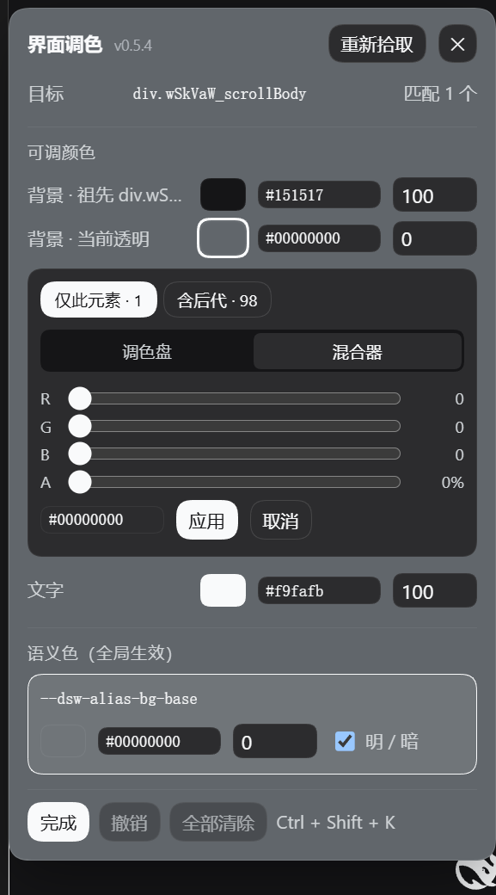
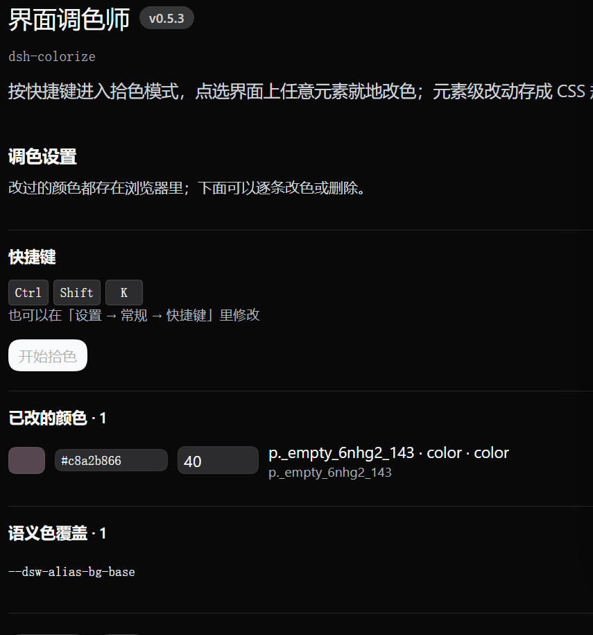

# dsh-colorize

**DSH 界面调色师** —— 按快捷键进拾色模式，点界面上任意元素就地改色。改的不是源码：
元素级改动存成一条 CSS 规则，颜色命中语义色时走主题 token 覆盖层。

[](https://github.com/ZinChl/dsh-colorize/actions/workflows/ci.yml)
[](LICENSE)
[](package.json)


只用官方 Client 服务：`slots`（浮层 / 设置行 / 插件页）、`shortcuts`（快捷键注册与改键）、
`theme`（token 覆盖层）、`locale`（文案）。**不进拾色模式时不跑任何定时器、不观察 DOM**。

## 三个入口

| 入口 | 位置 | 说明 |
| --- | --- | --- |
| **自定义色彩** 按钮 | 设置 → 常规（外观/字号下方、快捷键上方） | 鼠标入口，不依赖键盘，一定会出现 |
| 快捷键 `Ctrl+Shift+K` | 全局（macOS 上是 `Cmd+Shift+K`） | 走 DSH 官方快捷键注册表，在「设置 → 常规 → 快捷键」里可见、可改键、会报撞键 |
| 插件设置页 | 插件管理 → 全局插件 → 界面调色师 | 改快捷键、逐个改已改过的颜色、导出/导入 |

> `web:linux`（浏览器 + Linux）下**不提供**默认键位：DSH 对 Web 的 Linux 只放行三种组合，而它们都被官方命令占了；官方 `register()` 会原子校验所有平台的默认键位，给一个不合法的默认值会让整条命令注册失败。那里请用设置页按钮，或自己在快捷键编辑器里改。

## 安装

```bash
# 从 GitHub 装（会同时写 dependencies 与 dsh.profile.bundles 两处）
dsh plugin --profile web add github:ZinChl/dsh-colorize

# 重启进程让 profile 变更生效（Web GUI 刷新页面不够）
dsh web
```

也可以直接用某个 release 的 tarball（资产里带 `SHA256SUMS`，可先校验）：

```bash
dsh plugin --profile web add \
  https://github.com/ZinChl/dsh-colorize/releases/download/v0.5.3/dsh-colorize-0.5.3.tgz
```

本地开发时直接指向工作目录：`dsh plugin --profile web add /path/to/dsh-colorize`。

改了 `client.js` 之后**刷新页面（F5）就够**（宿主每次页面加载都从磁盘读客户端模块），
不需要重启 profile、也不需要关/开 bundle。

## 用法

1. 点「开始拾色」或按快捷键进入**拾色模式**：光标变十字，鼠标划过的元素被高亮框住，角标显示它的 `tag.class`。
2. 单击确认，浮动面板贴着元素弹出，列出它**实际生效**的颜色属性：背景 / 文字 / 边框（四边同色时合并成一条）/ SVG 的填充与描边。
   每行都可以**直接改**：点色块开取色器，或直接在行内的 `HEX` 框（回车提交、`Esc` 取消、非法输入自动还原）
   和不透明度框（0–100，输入即时生效）里改 —— 不必进编辑器。
3. **取色器有两个可选方式**（默认「混合器」）：

   * **调色盘**：系统取色器（色轮 + 屏幕吸管）+ 15 个预设色；
   * **混合器**：R / G / B / A 滑杆 + HEX 输入。

   两种方式都能选「应用范围」（仅此元素 / 同类 N 个 / 含后代 N 个），拖动即时预览；
   按 **应用** 确认并退出、按 **取消** 精确还原到你打开编辑器前的值。改动写成一条 CSS 规则并立刻保存。
   行内改 hex 不会影响不透明度（alpha 单独保留）；反过来，行内改了不透明度时，开着的编辑器会立刻跟上同一个值。
   HEX 框半透明时会显示 8 位（40% → `#74fafb66`），想直接用 hex 设透明度就写 `#rrggbbaa`；只写 6 位则保留当前不透明度。
4. 面板底部的 **完成** 按钮只关闭面板；`Esc` 取消拾色，面板打开时 `Esc` 也会关掉面板。
   退出时高亮框与 tag 角标一定会一起消失；面板标题右侧的 `vX.Y.Z` 就是当前页面装载的构建版本。

**批量改色**：「应用范围」里的

* `同类 · N` = 把选择器里的 `:nth-of-type(n)` 去掉后的全部匹配（点一条消息 → 改所有同类消息）
* `含后代 · N` = 该元素 + 它所有后代（点对话容器 → 一次改掉里面所有文字颜色）

切换范围时已写的规则会一起搬过去，不会留下重复规则。

**背景色为什么有时「不生效」**：面板已按几种成因给出对应的行 ——



* 元素自己透明时**也会**给一行 `背景 · 当前透明`：直接改它 = 给这个元素上背景（画在祖先之上，一定看得见）；
* 目标有背景图（渐变/图片）时会标「含背景图」，应用时同时写 `background-image: none !important`，否则颜色被图盖住；
* 背景画在伪元素上时，会多出 `::before` / `::after` 背景行；
* 元素自己是透明的、可见色带属于**祖先**时，会自动补一行「背景 · 祖先 <tag.class>」；
* 元素自己是**容器**、可见色带由某个铺满的**子元素**绘制时（会话滚动区、卡片最常见），会补一行「背景 · 子元素 <tag.class>」。

> 「当前透明」那一行的值是 `rgba(0, 0, 0, 0)`（0%）。往里输入颜色会**按不透明写入** ——
> 0% 是「还没有颜色」的空位，不是你要的透明度；想调透明用旁边的透明度框。

若命中却被更高优先级的样式压住，行内会提示「已被更高优先级的样式覆盖（颜色写进去了但看不到）」。

> 为什么不用 `<input type="color">`：它打开的是系统级弹窗，确定按钮不在面板里，某些壳里甚至不出现 ——
> 于是「选完颜色无从确认」。自带取色器把确认动作放回面板内。

面板里还有：

| 控件 | 作用 |
| --- | --- |
| 重新拾取 | 回到拾色模式换一个元素 |
| 语义色（全局生效） | 当元素颜色正好等于某个主题 token 时出现；改它等于换整个界面的这个语义色，比元素级规则稳得多。这一行同样有行内 `HEX` 与不透明度（含 alpha 也不会有歧义） |
| 明/暗 | 勾选时同时写入 light / dark 两层；取消只改当前配色模式，另一模式保留主题原值 |
| 撤销 / 全部清除 | 按顺序回退整条规则表 |

## 插件设置页



* **快捷键**：显示当前键位，`修改` 进入录制（`Esc` 取消；只接受带修饰键的组合），`恢复默认` 回到 `Ctrl+Shift+K`。校验走 `describeBinding`，撞键 / 系统保留 / 浏览器不接受都会当场说明。
* **已改的颜色**：每条规则一行 —— 色块（点开同一套自带取色器）+ 行内 `HEX` 与不透明度 + 标签/选择器 + 删除。与浮层面板同一个 store。
* **语义色覆盖**：每个被覆盖的 token 一行，明/暗各一个色块（各自可打开取色器）。
* **导出 / 导入**：规则与 token 的 JSON。

## 为什么开销小

* **空闲时**只有：一个 `<style>` 标签、一条已注册的快捷键命令、一个渲染出 0 尺寸节点的 React 组件。没有 `setInterval`、没有 `MutationObserver`、没有 rAF 循环，也不监听键盘。
  （`npm run check:manifest` 会用正则把这两条拦死。）
* **持久化走样式表**：规则落进样式表后，React 重渲染、滚动、切主题都由浏览器自己应用，不经过 JS。
* **拾色模式**只加若干监听（`pointermove` + 鼠标按键拦截 + 拾色期间的 `Esc`），退出即摘除。移动按 rAF 每帧合并一次；**不做命中测试**（遮罩 `pointer-events: none`，直接读 `event.target`），每帧只读一次 `getBoundingClientRect`，高亮框用 `transform: translate3d()` 走合成器、并且只在几何/文案真的变化时才写样式。
* **语义色匹配**每次拾取最多探测 96 个 token，一次性的，不常驻。

实测（Chrome 154 / 915×1328 / 3 秒连续移动，同一负载）：

| 指标 | 0.2.0 | 0.3.0 |
| --- | --- | --- |
| 插件自身 `elementsFromPoint` 调用（每 3s） | 180 | **0** |
| 每次拾取移动的 rAF 回调耗时 | 0.425 ms | **0.318 ms** |
| 3s 帧间隔 p95 / 长任务 | 16.8ms / 0 | 17.0ms / 0 |

> 高亮浮层通过 `popover="manual"` 放在浏览器 **top layer**：DSH 的设置弹窗是 `body` 下 `z-index:1000` 的独立层，
> 应用 frame 的 `z-index:20` 在它下面，frame 内部再高的 z-index 也翻不过去 —— 提层之后浮层才能在设置弹窗之上显示。

## 两种改法，怎么选

* **元素级**（默认）：写 `选择器 { 属性: 值 !important }`。选择器优先用唯一 id、稳定的 `data-*` / `aria-label`，否则用最短的唯一祖先路径（必要时才补 `:nth-of-type`）；每个候选都用 `querySelectorAll` 验过唯一性，面板里也会显示「匹配 N 个」。
  优点：想改哪改哪。缺点：依赖 DOM 结构，DSH 升级后类名/层级变了可能失配（失配时规则静默失效，不会有副作用）。
* **语义色**：走 `theme.overrideTokens()` 覆盖层，不动主题注册表，卸载插件自动还原。改「整体配色」推荐这条。

## 存储与诊断

`localStorage["dsh-colorize:v1"]`，只存在当前浏览器 + 当前地址下。想彻底恢复：插件设置页 →「全部清除」，或删掉这条记录再刷新。

控制台里有 `window.__dshColorize`：

```js
__dshColorize.state()
// { version, picking, selected, rules, tokens, keys, commandRegistered,
//   bindingIssue, conflicts, modules }
```

`commandRegistered` / `keys` / `conflicts` 用来判断快捷键到底有没有注册上；`modules` 是模块求值计数，>1 说明客户端包被加载了两份（那种情况下组件和 API 会分属两个 store）；`version` 用来确认页面装载的是哪个构建。

## 开发

```bash
npm run check      # 语法检查 + 清单校验 + 单测（CI 跑的就是这个）
npm test           # 9 个离线单测：颜色解析 / 序列化 / alpha 判定
npm run check:manifest
```

仓库结构：

```
client.js              浏览器半边（全部逻辑：拾色、选择器、规则引擎、token 层、面板、设置页）
index.js               宿主半边（故意的空实现：只为让这个包是普通的 bundle 条目）
cordis.patch.yml       把本插件 insert 进 profile 的一行
dsh.plugin.json        给插件市场/社区看的清单（id / 版本 / contributes）
locale/{zh,en}.json    插件列表与设置页的文案元数据
scripts/check-manifest.mjs  清单一致性 + 零轮询守卫
tests/color.test.mjs   颜色数学单测（client.js 在 node:vm 里求值，靠 __DSH_COLORIZE_TEST__ 取内部函数）
docs/                  工作原理（internals）/ 验证方法（verification）/ 排错（troubleshooting）/ 发版说明
```

* 改代码前请读 [`docs/internals.md`](docs/internals.md)：那里的「四个界面一个 store」「alpha 不变量」
  「零轮询」都是踩过坑之后定下来的约束。
* 验收按 [`docs/verification.md`](docs/verification.md) 走（离线门禁 + 浏览器脚本化验收 + 真机手感）。
* 出问题先看 [`docs/troubleshooting.md`](docs/troubleshooting.md)。

发版：打 `v*` tag → CI 跑门禁 → `npm pack` → 自动建 Release 并附 tarball + `SHA256SUMS`。
发版说明写在 `docs/releases/<tag>.md`（工作流优先用它当 release notes）。

## 已知边界

* 只改颜色（含不透明度），不改圆角 / 字号 / 间距。
* 元素级规则用 `!important`，能压过 React 内联样式；但别的插件若用更高优先级的选择器写了同一属性，那就是它赢。
* 拾色时鼠标按键被窗口捕获阶段拦下（点选元素不会触发它自己的功能）；`Esc` 随时退出。
* 只声明 `web` 平台；桌面壳没有验证过。
* 内置 zh + en 两套字典；图标是原创 SVG。

## License

MIT © dw0x

---

[](https://github.com/deepseek-ai/deepseek-harness)

<sub>Built with [DeepSeek Harness](https://github.com/deepseek-ai) · powered by dsh</sub>
