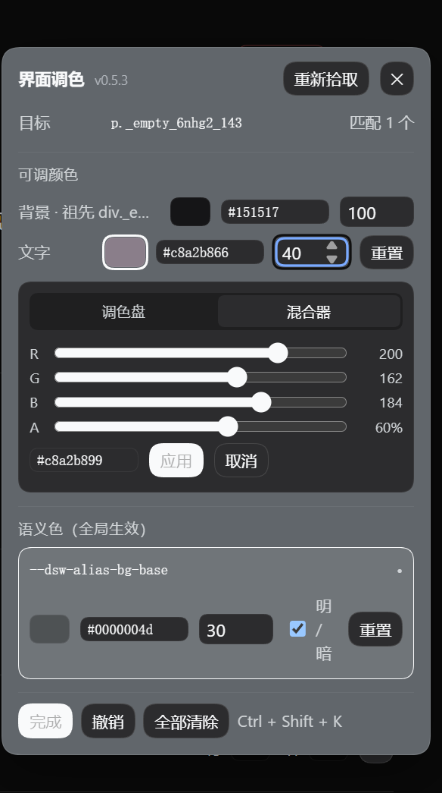

# dsh-colorize

**In-place UI colorizer for DeepSeek Harness** — hit a hotkey, click any element, recolor it.
Nothing is patched in the source: element edits become one CSS rule each, and a colour that matches a
semantic token is changed at the theme-token layer instead.

[中文说明 → README.md](README.md)

[](https://github.com/ZinChl/dsh-colorize/actions/workflows/ci.yml)
[](LICENSE)
[](package.json)



Built only on official Client services — `slots`, `shortcuts`, `theme`, `locale`. **While pick mode is off
the plugin runs no timer and no DOM observer**: one `<style>` tag, one registered shortcut command and a
zero-size React mount.

## What it does

| | |
| --- | --- |
| **Pick** | `Ctrl+Shift+K` (rebindable) / 设置 → 常规 →「自定义色彩」/ `__dshColorize.open()`. Hover highlights, click selects |
| **Recolor** | The panel lists the colours that are actually in effect: background / text / border (merged when all four sides match) / SVG fill & stroke |
| **Two pickers** | **Palette** (OS picker + eyedropper + 15 presets) and **Mixer** (R/G/B/A sliders + HEX), sharing one 应用 / 取消 footer |
| **Inline editing** | Every row edits `HEX` and opacity (0–100) in place, no editor needed. Opacity survives a hex edit, and a translucent colour shows as `#rrggbbaa` |
| **Bulk** | Scope: this element / N same-class / element + descendants — existing rules move with the scope |
| **Semantic colours** | When a colour equals a `--dsw-alias-*` token, editing it goes through `theme.overrideTokens`, so the whole UI follows |
| **Background triage** | Rows for 「含背景图」, `::before` / `::after`, the visible ancestor, and the covering child. A transparent element still gets its own `背景 · 当前透明` row, so its background is always editable |
| **Persistence** | Rules live in `localStorage`; the plugin page edits/removes them one by one, and imports/exports JSON |

## Install

```bash
dsh plugin --profile web add github:ZinChl/dsh-colorize
dsh web    # restart the process so the profile change takes effect
```

Or install a release tarball (assets ship a `SHA256SUMS`):

```bash
dsh plugin --profile web add \
  https://github.com/ZinChl/dsh-colorize/releases/download/v0.5.3/dsh-colorize-0.5.3.tgz
```

After editing `client.js`, a page refresh (F5) is enough — the host reads the client module from disk on
every page load. No profile restart, no bundle off/on.

## Development

```bash
npm run check      # syntax + manifest checks + unit tests (this is what CI runs)
npm test           # 9 offline tests for the colour maths
```

Read [`docs/internals.md`](docs/internals.md) before changing code: the store/one-subscription rule, the
alpha invariants and the zero-polling promise are all there because each of them was a real bug once.
Acceptance follows [`docs/verification.md`](docs/verification.md); problems start at
[`docs/troubleshooting.md`](docs/troubleshooting.md).

Release: push a `v*` tag → CI runs the gates → `npm pack` → a GitHub Release with the tarball and
`SHA256SUMS`. Notes come from `docs/releases/<tag>.md`.

## Limits

* Colours only (including opacity) — no radius, font size or spacing.
* Element rules use selectors + `!important`; a DSH rename can make them miss (they then simply do nothing).
* `web` platform only; the desktop shell has not been verified.
* On `web:linux` there is no default keybinding (DSH only admits three combinations there and all are
  taken); use the settings button or rebind it.

## License

MIT © dw0x

---

[](https://github.com/deepseek-ai/deepseek-harness)

<sub>Built with [DeepSeek Harness](https://github.com/deepseek-ai) · powered by dsh</sub>
